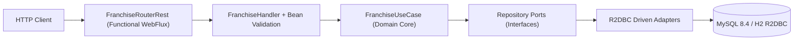

# Franchise Management Reactive API

API REST reactiva y no bloqueante desarrollada en **Java 21** y **Spring Boot 3.3 (Spring WebFlux)** bajo los principios de **Clean Architecture** (Puertos y Adaptadores). Gestiona redes de franquicias, sus sucursales asociadas y el catálogo de productos e inventario por sucursal.

---

## Arquitectura y Decisiones Técnicas

El sistema separa estrictamente las reglas de negocio del framework y los detalles de infraestructura, verificando el aislamiento en tiempo de construcción mediante **ArchUnit**:



1. **Programación Funcional y Reactiva (`Spring WebFlux` + `Project Reactor`):**
   * Exposición de endpoints mediante ruteo funcional (`RouterFunction<ServerResponse>` y `FranchiseHandler`) en lugar de controladores imperativos acoplados a anotaciones.
   * Flujos 100% no bloqueantes (`Mono<T>` / `Flux<T>`) desde la frontera HTTP hasta el driver **R2DBC**. Validado en la suite de pruebas mediante **BlockHound**.
2. **Persistencia Reactiva (`Spring Data R2DBC` + `Flyway`):**
   * Modelo relacional normalizado (`franchises` 1:N `branches` 1:N `products`) con restricciones de unicidad e índices compuestos `(branch_id, stock DESC)`.
   * La consulta del **producto con mayor stock por sucursal para una franquicia** se resuelve en una única operación SQL utilizando la función de ventana `ROW_NUMBER() OVER (PARTITION BY b.id ORDER BY p.stock DESC, p.id ASC)`, evitando el problema de $N+1$ consultas en memoria.
3. **Estandarización de Errores (`RFC 9457 ProblemDetail`):**
   * Manejo centralizado en `GlobalErrorWebExceptionHandler` devolviendo respuestas `application/problem+json` con códigos de dominio semánticos (`400 Bad Request`, `404 Not Found`, `409 Conflict`).

---

## Estructura del Proyecto

```text
├── Dockerfile                          # Construcción multi-stage (JDK 21 -> JRE 21 no-root con capas extraídas)
├── docker-compose.yml                  # Orquestación local: MySQL 8.4 + API Reactiva con healthchecks
├── api-requests.http                   # Colección HTTP dinámica para los 10 endpoints y casos de error RFC 9457
├── infra/
│   ├── terraform/                      # IaC en Terraform (VPC, Subnets públicas/privadas, IGW/NAT, ALB, ECS Fargate, RDS MySQL 8.4, ECR)
│   └── cloudformation/                 # Plantilla equivalente en AWS CloudFormation con paridad completa
└── src/
    ├── main/java/com/franchise/
    │   ├── domain/
    │   │   ├── exception/              # Excepciones de negocio y catálogo ErrorCode
    │   │   ├── model/                  # Records inmutables (Franchise, Branch, Product) y Gateways
    │   │   └── usecase/                # Orquestación reactiva pura (FranchiseUseCase)
    │   └── infrastructure/
    │       ├── config/                 # Inyección de casos de uso y configuración OpenAPI
    │       ├── drivenadapter/r2dbc/    # Entidades R2DBC, repositorios reactivos y adaptadores
    │       └── entrypoint/reactiveweb/ # RouterRest, Handler, validación y manejador RFC 9457
    └── test/java/com/franchise/
        ├── architecture/               # Reglas ArchUnit (aislamiento de dominio, capas y ciclos)
        ├── config/                     # Integración compartida de BlockHound para hilos NonBlocking
        ├── domain/usecase/             # Pruebas unitarias reactivas con StepVerifier y BlockHound
        └── infrastructure/
            ├── drivenadapter/r2dbc/    # Pruebas unitarias de adaptadores reactivos y mapeo de errores SQL
            └── entrypoint/reactiveweb/ # Integración WebTestClient (H2 R2DBC y Testcontainers MySQL 8.4)
```

---

## Ejecución desde Entorno Local

### Prerrequisitos
* **JDK 21** (o **Docker** y **Docker Compose** si se ejecuta contenerizado).

### Opción 1: Despliegue Completo con Docker Compose (MySQL 8.4 + API)
Levanta una instancia real de **MySQL 8.4**, ejecuta las migraciones **Flyway** y expone el servicio en el puerto `8080`:

```bash
docker compose up --build -d
```

Verificar estado de salud:
```bash
curl http://localhost:8080/actuator/health
```

### Opción 2: Ejecución Directa con Maven Wrapper (Perfil Local In-Memory R2DBC)
Por defecto, si no se definen variables de entorno de MySQL externo, la aplicación arranca de forma autónoma sobre **R2DBC en modo de compatibilidad MySQL** con migraciones Flyway automáticas (sin requerir demonios externos):

```bash
# En Linux / macOS
./mvnw spring-boot:run

# En Windows (PowerShell)
.\mvnw.cmd spring-boot:run
```

* **Swagger UI (Documentación Interactiva OpenAPI 3):** `http://localhost:8080/swagger-ui.html`
* **OpenAPI JSON Spec:** `http://localhost:8080/v3/api-docs`

---

## Ejecución de Pruebas y Cobertura

Para ejecutar las pruebas unitarias (`StepVerifier` + `BlockHound` sobre hilos `NonBlocking`), las pruebas de integración aisladas (`WebTestClient` sobre H2 R2DBC y `Testcontainers` sobre `mysql:8.4.8` real cuando hay un demonio Docker activo), la validación arquitectónica (`ArchUnit` verificando pureza del dominio, arquitectura en capas y ausencia de ciclos) y las puertas de calidad de cobertura (`JaCoCo` exigiendo un mínimo de **80% en instrucciones y 80% en ramas**):

```bash
./mvnw clean verify
```

El reporte de cobertura se genera en `target/site/jacoco/index.html`.

---

## Referencia de Endpoints

Para probar los 10 endpoints de forma interactiva y secuencial:
* **Colección HTTP lista para ejecutar:** Abrir el archivo `api-requests.http` en la raíz del proyecto (compatible con el cliente HTTP de IntelliJ IDEA y la extensión *REST Client* de VS Code).
* **Documentación Interactiva Swagger UI:** Acceder a `http://localhost:8080/swagger-ui.html` una vez iniciada la aplicación.

| Requisito | Método | Endpoint | Cuerpo de Petición (JSON) | Respuesta |
| :--- | :--- | :--- | :--- | :--- |
| **1. Crear franquicia** | `POST` | `/api/v1/franchises` | `{"name": "Franquicia Norte"}` | `201 Created` |
| **2. Actualizar nombre de franquicia** *(Extra)* | `PATCH` | `/api/v1/franchises/{franchiseId}` | `{"name": "Franquicia Global"}` | `200 OK` |
| **3. Consultar detalle de franquicia** | `GET` | `/api/v1/franchises/{franchiseId}` | — | `200 OK` |
| **4. Agregar sucursal a franquicia** | `POST` | `/api/v1/franchises/{franchiseId}/branches` | `{"name": "Sucursal Centro"}` | `201 Created` |
| **5. Actualizar nombre de sucursal** *(Extra)* | `PATCH` | `/api/v1/franchises/{franchiseId}/branches/{branchId}` | `{"name": "Sucursal Parque"}` | `200 OK` |
| **6. Agregar producto a sucursal** | `POST` | `/api/v1/franchises/{franchiseId}/branches/{branchId}/products` | `{"name": "Café Origen", "stock": 150}` | `201 Created` |
| **7. Eliminar producto de sucursal** | `DELETE` | `/api/v1/franchises/{franchiseId}/branches/{branchId}/products/{productId}` | — | `204 No Content` |
| **8. Modificar stock de producto** | `PATCH` | `/api/v1/franchises/{franchiseId}/branches/{branchId}/products/{productId}/stock` | `{"stock": 280}` | `200 OK` |
| **9. Actualizar nombre de producto** *(Extra)* | `PATCH` | `/api/v1/franchises/{franchiseId}/branches/{branchId}/products/{productId}` | `{"name": "Café Especial"}` | `200 OK` |
| **10. Producto con mayor stock por sucursal** | `GET` | `/api/v1/franchises/{franchiseId}/top-stock-products` | — | `200 OK` |

### Ejemplo de Respuesta: Producto con Mayor Stock por Sucursal
`GET /api/v1/franchises/1/top-stock-products`
```json
[
  {
    "branchId": 1,
    "branchName": "Sucursal El Poblado",
    "productId": 2,
    "productName": "Café Cumbre Reserva",
    "stock": 450
  },
  {
    "branchId": 2,
    "branchName": "Sucursal Bogotá",
    "productId": 4,
    "productName": "Nevado Arequipe",
    "stock": 310
  }
]
```

---

## Infraestructura como Código (IaC)

El directorio `infra/` incluye dos alternativas equivalentes para aprovisionar la topología completa en AWS: red aislada (**VPC** con subredes públicas y privadas en múltiples zonas de disponibilidad, **Internet Gateway** y **NAT Gateway**), capa de cómputo (**Application Load Balancer**, **Amazon ECS Fargate Service & Task Definition**, **CloudWatch Logs** y roles **IAM** de mínimo privilegio), capa de persistencia (**Amazon RDS MySQL 8.4** con `ManageMasterUserPassword`, autenticación IAM habilitada e inyección segura desde **AWS Secrets Manager** hacia las tareas ECS) y registro de contenedores (**Amazon ECR** con escaneo al subir y política de retención de ciclo de vida):

* **Terraform (`infra/terraform/`):**
  ```bash
  cd infra/terraform
  terraform fmt -check -recursive
  terraform init
  terraform plan -var="environment=prod"
  ```
* **AWS CloudFormation (`infra/cloudformation/franchise-stack.yaml`):**
  ```bash
  cfn-lint infra/cloudformation/franchise-stack.yaml
  aws cloudformation validate-template --template-body file://infra/cloudformation/franchise-stack.yaml
  ```

---

## Limitaciones Conocidas y Trade-offs

* **Desempate en Top Stock por Sucursal:** Cuando una sucursal tiene dos productos empatados con el mismo stock máximo, la ventana `ROW_NUMBER() OVER (PARTITION BY b.id ORDER BY p.stock DESC, p.id ASC)` selecciona de forma determinista el producto registrado primero (`id ASC`) para garantizar exactamente un producto líder por sucursal.
* **Recarga de Credenciales ante Rotación de Secrets Manager:** Las tareas de ECS Fargate inyectan la contraseña administrada de RDS desde AWS Secrets Manager al iniciar el contenedor (`valueFrom`). Si Secrets Manager rota la contraseña del usuario maestro mientras el servicio está en ejecución, se requiere un redespliegue rodante (`aws ecs update-service --force-new-deployment`) o un adaptador de tokens IAM para renovar las conexiones del pool sin reiniciar las tareas.
* **Transacciones Distribuidas:** El servicio opera sobre una única base de datos relacional reactiva; en caso de escalar a eventos de dominio hacia otros microservicios, se recomienda incorporar una tabla *Transactional Outbox*.
